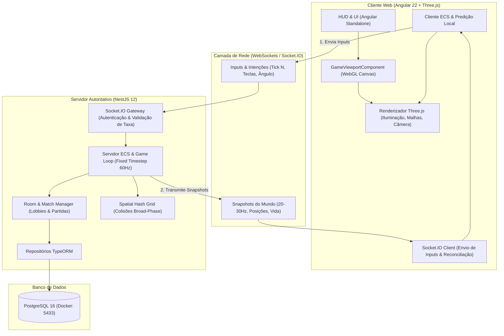

# Arquitetura do Sistema - Brick Survivors: Overdrive

Este documento descreve os padrões arquiteturais, limites de contexto e design de engenharia adotados no **Brick Survivors: Overdrive**.

---

## 1. Visão Geral da Arquitetura

O sistema adota uma **Arquitetura Desacoplada e Autoritativa**, projetada para permitir alta fidelidade gráfica no navegador via WebGL (Three.js) mantendo a simulação física, validações e regras de negócio determinísticas e portáveis.

---

## 2. Princípios de Separação de Camadas

### 2.1 Separação Rígida entre Simulação e Renderização
- **Camada de Simulação (Motor Lógico / ECS)**:
  - Não importa nem referencia tipos ou classes do Three.js (`THREE.Mesh`, `THREE.Scene`, `THREE.Vector3`).
  - Utiliza tipos primitivos e estruturas puras de dados (`{ x: number, y: number, z: number }`).
  - É 100% determinística e pode rodar tanto no cliente (para predição imediata) quanto no backend (para autoridade e validação).
- **Camada de Apresentação (View / Renderer)**:
  - Consome o estado do ECS e atualiza as malhas 3D (`Mesh`, `InstancedMesh`), luzes, partículas e câmera.
  - Implementa interpolação suave (`lerp`/`slerp`) entre frames renderizados e os ticks da simulação física.

### 2.2 Padrão Dumb & Smart Components no Angular
- **Smart Components (Containers)**:
  - Gerenciam o ciclo de vida do jogo, conexões de socket, navegação de rotas e injeção de dependências.
- **Dumb Components (Apresentação Pura)**:
  - O `GameViewportComponent` é um Dumb Component focado estritamente em hospedar o canvas WebGL, capturar eventos de entrada (mouse/teclado) e repassar via `@Output()`, além de receber configurações visuais via `@Input()`.

---

## 3. Padrão ECS (Entity Component System)

Para evitar os problemas clássicos de acoplamento de herança orientada a objetos (`God Objects`), o domínio do jogo utiliza o padrão ECS:

1. **Entities**: Identificadores numéricos opacos (`entityId: number`).
2. **Components**: Apenas dados (sem métodos de negócio).
   - `TransformComponent`: Posição (`x, y, z`), rotação (`rotationY`) e escala.
   - `VelocityComponent`: Vetor de velocidade linear e angular.
   - `VehicleComponent`: Potência de motor, esterçamento, atrito e referência ao condutor.
   - `DestructibleBrickComponent`: Ponto de ancoragem, vida do bloco, massa e índice de instância.
   - `HealthComponent`: Pontos de vida e invulnerabilidade temporária.
3. **Systems**: Funções ou classes puras que iteram sobre entidades com componentes específicos:
   - `MovementSystem`: Aplica aceleração, atrito e velocidade à posição.
   - `CollisionSystem`: Resolve testes de colisão usando Spatial Partitioning.
   - `DestructionSystem`: Desprende blocos de veículos danificados e dispara impulso físico.

---

## 4. Netcode Autoritativo e Temporalidade

### 4.1 Game Loop com Fixed Timestep
- O loop de física roda em **60 Hz fixo** (`dt = 1/60s ≈ 16.66ms`) através de um acumulador de tempo, evitando qualquer divergência causada por variações na taxa de quadros (FPS) da GPU do cliente.

### 4.2 Predição do Cliente e Reconciliação do Servidor
1. O jogador local pressiona um comando (ex: acelerar). O cliente aplica o efeito imediatamente em seu próprio ECS local e armazena o comando em uma fila com o `sequenceNumber`.
2. O servidor processa o input no seu próximo tick autoritativo e envia de volta um snapshot contendo a última entrada reconhecida (`lastProcessedInput`).
3. Ao receber a confirmação do servidor, o cliente:
   - Descarta os inputs já processados pelo servidor.
   - Verifica se a posição local diverge da posição do servidor além de uma margem de tolerância.
   - Se houver divergência, reconcilia reposicionando a entidade e reaplicando os inputs pendentes da fila.

---

## 5. Estratégia de Banco de Dados e Persistência

- **PostgreSQL 16** via TypeORM.
- Utilização estrita de **Migrations versionadas com timestamp de 13 dígitos** (`Date.now()`), garantindo idempotência e ordenação absoluta.
- Persistência focada em dados assíncronos: contas de jogadores, inventário de peças e blocos montáveis, estatísticas de partidas e rankings. O tráfego de alta frequência do gameplay (posições de veículos e tiros) trafega exclusivamente em memória (RAM) no servidor e via Socket.IO.
